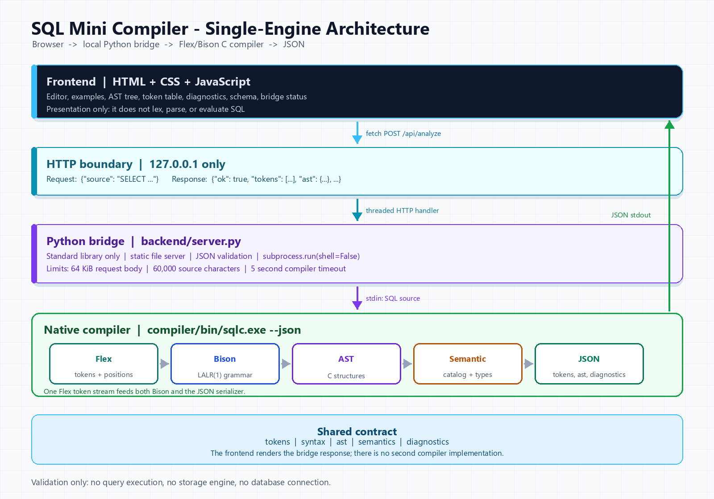
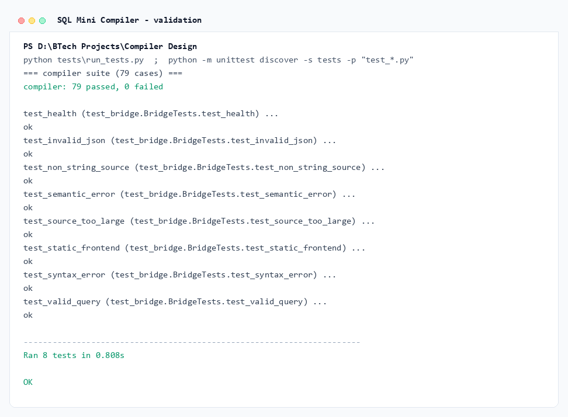
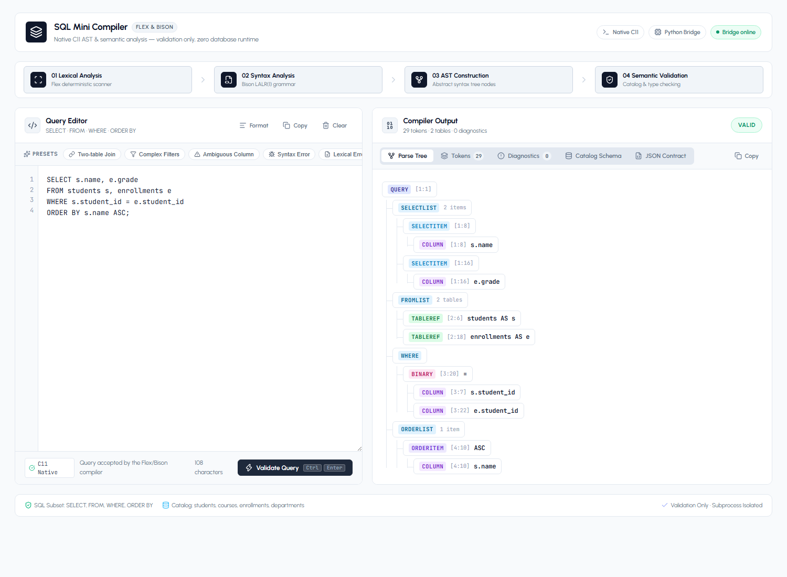
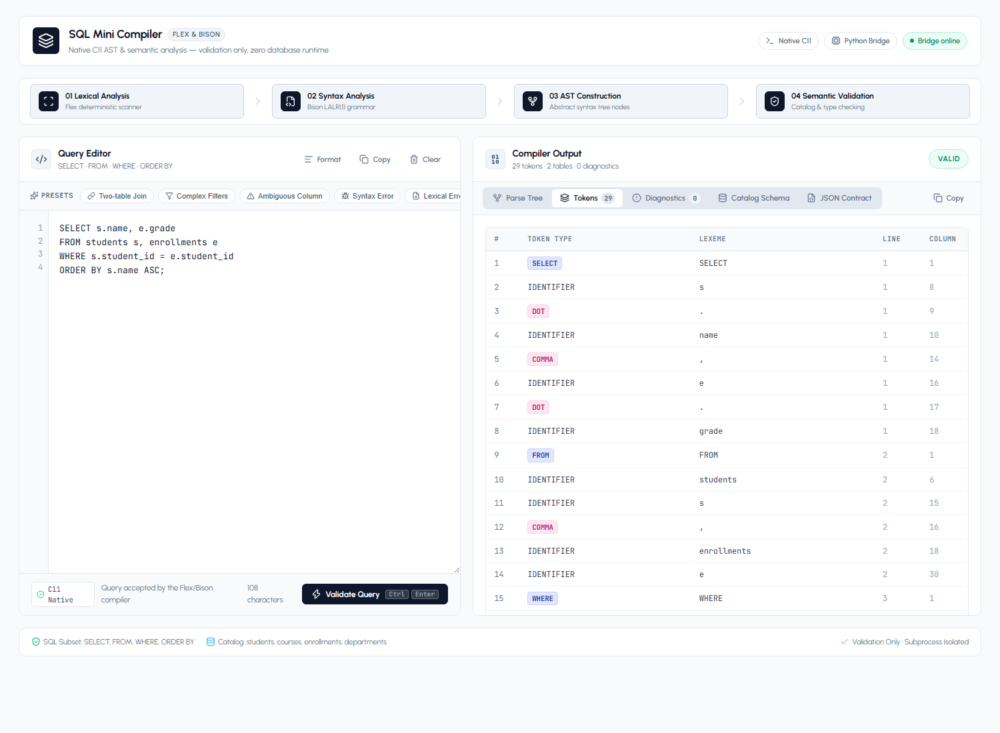
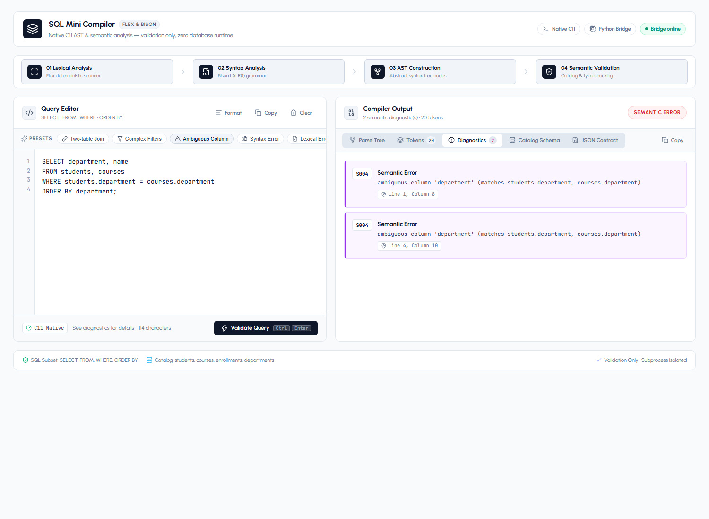
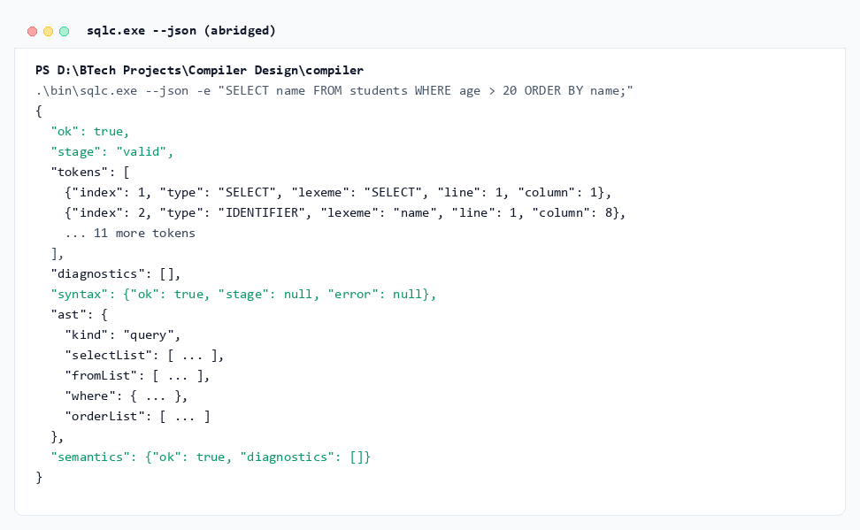

# SQL Mini Compiler

**A Single-Engine Front-End for a Restricted SQL Subset**

| Field | Details |
| --- | --- |
| Course | Compiler Design |
| Programme | B.Tech (Computer Science and Engineering) |
| Department | `Department of Computer Science and Engineering` |
| Institution | `Amal Jyothi College of Engineering` |
| Academic year | 2026-27 |
| Course guide | `<Faculty Name>` |
| Submitted by | `<Member 1>` (`<Roll No.>`), `<Member 2>` (`<Roll No.>`), `<Member 3>` (`<Roll No.>`), `<Member 4>` (`<Roll No.>`) |
| Date | October 2026 |

## Declaration

We declare that this project report describes work carried out by our team for the Compiler Design course. The implementation, test suite, screenshots, and documentation included in this submission were prepared by the team members listed on the cover page. Sources of background information are acknowledged in the References section.

This project validates a restricted SQL subset. It does not execute queries and does not connect to any database.

| Name | Signature |
| --- | --- |
| `<Member 1>` | |
| `<Member 2>` | |
| `<Member 3>` | |
| `<Member 4>` | |

## Acknowledgement

We thank our course guide, `<Faculty Name>`, for guidance on compiler phases, grammar design, and semantic analysis. We also thank the Department of `Department of Computer Science and Engineering` at `Amal Jyothi College of Engineering` for providing the laboratory and software environment used to build and test the project.

## Abstract

SQL is declarative, but reading and validating a query still follows the classical compiler pipeline: characters become tokens, tokens are parsed against a grammar, a syntax tree is built, and semantic rules are checked against a schema. This project implements that pipeline for a deliberately restricted SQL subset centred on `SELECT`, `FROM`, `WHERE`, and `ORDER BY`.

The submission uses one active implementation. A Flex scanner and a Bison LALR(1) grammar are compiled into a C11 executable. The same scanner records the tokens that are later serialized, so token positions are never recomputed by a second lexer. The C semantic layer resolves names against a fixed four-table catalog, checks types and aliases, and produces stable `L`, `P`, and `S` diagnostics. A Python standard-library HTTP bridge invokes the compiler with `--json`, and a dependency-free HTML/CSS/JavaScript frontend renders tokens, syntax status, AST, diagnostics, and catalog information.

The compiler passes all 79 cases in the shared suite: 30 valid queries, 25 semantic errors, 20 syntax errors, and 4 lexical errors. Eight bridge integration tests cover static serving, valid and invalid analysis, malformed JSON, field validation, and request limits. The earlier pure-C and in-browser prototypes are retained under `archive/` as design history, but they are not part of the active build or test path.

**Keywords:** compiler front-end, lexical analysis, Flex, Bison, LALR, abstract syntax tree, semantic analysis, SQL, Python bridge, JavaScript.

## 1. Introduction

### 1.1 Problem Statement

A database system must decide whether a query is well formed before it can plan or execute it. That decision requires several compiler-style checks:

1. Are the characters grouped into valid tokens?
2. Does the token sequence match the query grammar?
3. Can the referenced tables and columns be resolved?
4. Are operators applied to compatible types?
5. Are aliases and ordering clauses used consistently?

The project answers these questions for a small SQL dialect. It is a front-end only: the output is a token stream, a parse tree, a validity decision, and, when needed, a diagnostic with a source position.

### 1.2 Motivation

A complete database engine is too large for a single course project, but a restricted SQL front-end contains the same core ideas as a general-purpose compiler:

- a scanner with keywords, identifiers, literals, operators, comments, and position tracking;
- a context-free grammar with precedence and associativity;
- a parser that must reject malformed input precisely;
- a semantic phase that depends on external symbol information, here a fixed catalog;
- a stable machine-readable interface that a user interface can consume.

The project also addresses a practical question: how can a browser demonstration remain honest about the implementation being demonstrated? The answer is to keep the compiler in one place. The browser does not contain a second lexer, parser, or semantic checker. It sends source text to a local bridge, and the bridge returns the native compiler's JSON output.

### 1.3 Scope

Included:

- `SELECT` with optional `DISTINCT`, star projection, expressions, and aliases;
- `FROM` with comma-separated tables and optional table aliases;
- `WHERE` with boolean expressions, comparisons, arithmetic, `LIKE`, `IN`, `BETWEEN`, and `IS NULL`;
- `ORDER BY` with `ASC`, `DESC`, column names, select aliases, and ordinal positions;
- comments, quoted strings, case-insensitive keywords, and an optional semicolon;
- semantic validation against a fixed four-table catalog;
- JSON output, a local Python bridge, and a browser frontend;
- a 79-case compiler suite and an 8-case bridge suite.

Excluded:

- query execution and database connectivity;
- `JOIN ... ON`, subqueries, `GROUP BY`, `HAVING`, `UNION`, and data-modification statements;
- aggregate functions and user-defined functions;
- cost-based optimization and code generation;
- authentication, remote deployment, or multi-user server operation.

### 1.4 Objectives

1. Define a precise grammar for the restricted SQL subset.
2. Implement lexical analysis with useful diagnostics and one-based source positions.
3. Implement LALR(1) syntax analysis with Flex and Bison.
4. Build an explicit AST that preserves query structure and source locations.
5. Implement catalog-aware semantic checks and type rules.
6. Serialize tokens, syntax status, AST, and diagnostics as stable JSON.
7. Provide a local bridge and browser interface for interactive validation.
8. Validate the compiler and the bridge with automated tests.
9. Produce a complete submission package: report, presentation, screenshots, build scripts, and contribution notes.

### 1.5 Main Contributions

- A single native compiler using Flex, Bison, and shared C semantic modules.
- A JSON mode that emits the same token stream that Bison consumes.
- A local Python bridge that isolates the compiler behind a small HTTP API.
- A browser frontend that renders the compiler response without reimplementing it.
- A consistent diagnostic model spanning lexical, syntax, and semantic phases.
- A 79-case compiler regression suite and an 8-case bridge integration suite.
- Reproducible build, diagram, screenshot, report, and presentation scripts.

## 2. Background

### 2.1 Compiler Phases

A compiler front-end is usually divided into phases:

| Phase | Input | Output | Project implementation |
| --- | --- | --- | --- |
| Lexical analysis | characters | tokens with positions | `compiler/src/lexer.l` |
| Syntax analysis | tokens | AST | `compiler/src/parser.y` |
| Semantic analysis | AST + catalog | typed result or diagnostics | `compiler/src/semantic.c` |
| Serialization | tokens, AST, diagnostics | JSON | `compiler/src/json_output.c` |

The phases are deliberately separated in the source, but the token stream is shared. The lexer appends each emitted token to a recording list, and the JSON serializer reads that list. It does not run a second scanner.

### 2.2 Why SQL Is a Useful Case Study

SQL has a compact surface syntax but meaningful semantic dependencies. A query can be syntactically perfect and still be wrong because a table does not exist, a column is misspelled, a qualifier is unknown, or two tables expose the same column name. This makes SQL a useful vehicle for name resolution and type checking without requiring a full database engine.

The chosen subset covers the parts of SQL that map cleanly to compiler theory:

- a fixed keyword set and identifier rules;
- a stratified expression grammar;
- alias scopes in `FROM`;
- predicates with different operand rules;
- ordering clauses with aliases and ordinals.

### 2.3 Flex and Bison

Flex turns a set of regular-expression rules into a C scanner. The project uses Flex for keywords, identifiers, numeric and string literals, operators, comments, and position tracking.

Bison turns a context-free grammar into an LALR(1) parser. The project uses a stratified grammar: `OR` contains `AND`, `AND` contains `NOT`, predicates contain arithmetic, and arithmetic is split into additive and multiplicative levels. This encodes precedence directly in the grammar and produces an AST in the parser actions.

The generated files `lex.yy.c` and `parser.tab.c` are not edited by hand. The source specifications are `lexer.l` and `parser.y`.

### 2.4 Semantic Analysis with a Catalog

The semantic phase needs a symbol table. In this project the symbol table is a fixed catalog of four tables. Resolution answers three questions:

1. Which table does a qualifier refer to?
2. Which table contains an unqualified column?
3. Is the reference ambiguous because more than one table contains it?

Type rules then decide whether an operator, predicate, `WHERE` clause, or `ORDER BY` expression is acceptable.

## 3. System Analysis and Design

### 3.1 Functional Requirements

| ID | Requirement |
| --- | --- |
| FR1 | Recognize the supported SQL tokens and report lexical errors. |
| FR2 | Parse the supported grammar and report syntax errors with positions. |
| FR3 | Build an AST for a syntactically valid query. |
| FR4 | Resolve table names, aliases, and columns against the demo catalog. |
| FR5 | Detect ambiguous references, duplicate aliases, and type misuse. |
| FR6 | Print a human-readable result and a JSON result. |
| FR7 | Serve the frontend and analyze requests through a local bridge. |
| FR8 | Run the compiler test suite and bridge tests automatically. |

### 3.2 Non-Functional Requirements

- **Determinism:** the same source always produces the same diagnostics and JSON shape.
- **Locality:** the bridge binds to `127.0.0.1` and starts no remote service.
- **Isolation:** the compiler runs as a subprocess; malformed requests cannot corrupt the bridge.
- **Bounded work:** request size, source size, and compiler runtime are limited.
- **Portability:** the compiler uses C11, Flex, and Bison; the bridge uses only the Python standard library.
- **Maintainability:** phase boundaries are visible in the file structure and documented in this report.

### 3.3 Architecture



The active system has four layers:

1. **Frontend:** HTML, CSS, and JavaScript. It provides the editor, examples, AST tree, token table, diagnostics, schema, and bridge status.
2. **HTTP boundary:** `POST /api/analyze` accepts `{"source": "..."}` and returns the compiler's JSON result. `GET /api/health` reports availability.
3. **Python bridge:** `backend/server.py` validates the request, invokes `compiler/bin/sqlc.exe --json`, and serves the static frontend. It never evaluates SQL.
4. **Native compiler:** the Flex scanner, Bison parser, C AST and semantic modules, and JSON serializer.

The compiler is the single source of truth. The frontend has no fallback lexer or parser.

### 3.4 Data Flow

```text
User types SQL
  -> frontend serializes {"source": text}
  -> bridge checks method, body size, and JSON shape
  -> subprocess: sqlc.exe --json (source on stdin)
  -> Flex records tokens and feeds Bison
  -> Bison builds the AST
  -> semantic pass adds diagnostics
  -> json_output.c writes one JSON object to stdout
  -> bridge parses the JSON and returns HTTP 200
  -> frontend renders tokens, AST, diagnostics, and status
```

Analysis failures are application results, not transport failures. A lexical, syntax, or semantic error returns HTTP 200 with `"ok": false`. Invalid JSON, a missing `source` string, an oversized body, a missing binary, a subprocess timeout, or malformed compiler output produces a 4xx/5xx error with `{"error": {"code": "...", "message": "..."}}`.

### 3.5 Module Design

| Module | Responsibility |
| --- | --- |
| `compiler/src/lexer.l` | Token rules, comments, positions, token recording |
| `compiler/src/parser.y` | LALR grammar and AST-building actions |
| `compiler/src/ast.c` | AST constructors, destructors, text printer |
| `compiler/src/semantic.c` | Scope, name resolution, type checks, diagnostics |
| `compiler/src/catalog.c` | Four-table demo schema |
| `compiler/src/json_output.c` | JSON serialization and token list ownership |
| `compiler/src/main.c` | CLI parsing, phase orchestration, exit codes |
| `backend/server.py` | HTTP server, request validation, subprocess call |
| `frontend/app.js` | Rendering, examples, tabs, bridge calls |
| `tests/run_tests.py` | JSON compiler suite runner |
| `tests/test_bridge.py` | HTTP integration tests |

### 3.6 JSON Contract

The bridge and frontend depend on a stable shape:

```json
{
  "ok": false,
  "stage": "semantic",
  "tokens": [
    {"index": 1, "type": "SELECT", "lexeme": "SELECT", "line": 1, "column": 1}
  ],
  "diagnostics": [
    {"code": "S003", "phase": "semantic", "line": 1, "column": 8, "message": "column 'missing' does not exist"}
  ],
  "syntax": {"ok": true, "stage": null, "error": null},
  "ast": {"kind": "query", "selectList": [], "fromList": [], "where": null, "orderList": []},
  "semantics": {"ok": false, "diagnostics": []}
}
```

- `stage` is `valid`, `lexical`, `syntax`, or `semantic`.
- `diagnostics` contains all phases; `semantics.diagnostics` is the semantic subset.
- A lexical or syntax failure sets `ast` to `null`.
- A semantic failure keeps the AST so the UI can display the accepted structure.

### 3.7 Diagnostic Design

Diagnostics carry a code, a phase, a message, and one-based line and column numbers. Codes are stable and grouped by phase:

| Prefix | Phase | Examples |
| --- | --- | --- |
| `L` | Lexical | illegal character, unterminated string, unterminated comment |
| `P` | Syntax | unexpected token, expected token, empty input |
| `S` | Semantic | unknown table, ambiguous column, type mismatch |

The complete list appears in Appendix B.

## 4. Language and Catalog

### 4.1 Concrete Syntax

```sql
SELECT [DISTINCT] select_list
FROM table_list
[WHERE expression]
[ORDER BY order_list];
```

A select item is `*` or an expression with an optional alias. A table reference is a table name with an optional alias. Order items are expressions followed by optional `ASC` or `DESC`.

### 4.2 Precedence

From lowest to highest:

| Level | Operators | Associativity |
| --- | --- | --- |
| 1 | `OR` | Left |
| 2 | `AND` | Left |
| 3 | `NOT` | Right (prefix) |
| 4 | comparisons, `LIKE`, `IN`, `BETWEEN`, `IS NULL` | Non-chaining |
| 5 | `+`, `-` | Left |
| 6 | `*`, `/` | Left |
| 7 | unary `+`, unary `-` | Right |
| 8 | parentheses, columns, literals | Highest |

Consequences:

- `a OR b AND c` parses as `a OR (b AND c)`.
- `NOT age = 18` parses as `NOT (age = 18)`.
- `age BETWEEN 18 AND 25 AND cgpa > 7` parses as `(age BETWEEN 18 AND 25) AND (cgpa > 7)`.
- `a + b * c` parses as `a + (b * c)`.

### 4.3 Demo Catalog

| Table | Columns |
| --- | --- |
| `students` | `student_id INTEGER`, `name TEXT`, `age INTEGER`, `department TEXT`, `cgpa FLOAT`, `city TEXT` |
| `courses` | `course_id INTEGER`, `title TEXT`, `credits INTEGER`, `department TEXT` |
| `enrollments` | `enrollment_id INTEGER`, `student_id INTEGER`, `course_id INTEGER`, `grade TEXT`, `semester INTEGER` |
| `departments` | `department TEXT`, `hod TEXT`, `building TEXT`, `budget FLOAT` |

The catalog is static. The compiler does not inspect a live database schema.

### 4.4 Supported and Excluded Constructs

Supported:

- `SELECT`, `DISTINCT`, star projection, expressions, `AS` and implicit aliases;
- comma-separated `FROM` with table aliases;
- arithmetic, comparisons, boolean logic, parentheses;
- `LIKE`, `IN`, `BETWEEN`, `IS NULL`, and their negated forms;
- `ORDER BY` with columns, aliases, ordinals, `ASC`, and `DESC`;
- line comments, block comments, quoted strings, optional semicolons.

Excluded:

- explicit `JOIN ... ON`;
- subqueries, `GROUP BY`, `HAVING`, `UNION`;
- aggregates and user-defined functions;
- `INSERT`, `UPDATE`, `DELETE`, and DDL;
- execution, storage, transactions, and optimization.

## 5. Implementation

### 5.1 Compiler Build Pipeline

```text
lexer.l  +  parser.y
      |
      +-- WSL flex / bison --> lex.yy.c, parser.tab.c, parser.tab.h
      |
      +-- MinGW GCC --------> compiler/bin/sqlc.exe
```

On Windows, `compiler/build.ps1` runs Bison and Flex inside WSL, then compiles the generated C with MinGW GCC. On Linux or macOS, the `Makefile` performs the same steps directly.

### 5.2 Lexical Analysis

`lexer.l` recognizes:

- keywords and identifiers;
- integer and floating-point literals;
- quoted strings with doubled-quote escaping;
- `--`, `//`, and `/* ... */` comments;
- one- and two-character operators;
- punctuation.

Each token carries a one-based line and column. The `EMIT` macro increments the token count, appends the token to the JSON recording list, optionally prints it, and returns the token to Bison. Recording at emission time is important: the JSON token table and the parser input are guaranteed to describe the same token stream.

Lexical diagnostics:

| Code | Meaning |
| --- | --- |
| `L001` | Illegal character |
| `L002` | Unterminated string literal |
| `L003` | Unterminated block comment |

### 5.3 Syntax Analysis

`parser.y` is an LALR(1) grammar with no conflict declarations. List productions are left-recursive:

```text
select_list -> select_list COMMA select_item
             | select_item
```

Expression levels are stratified so precedence is visible in the grammar rather than in a table of conflict resolutions. Bison actions call AST constructors from `ast.c`. The grammar sets `%expect 0`, so a grammar change that introduces a conflict is treated as a build problem.

Syntax failures produce `P001` or `P002` with the position of the unexpected or expected token. A failed parse does not produce an AST.

### 5.4 AST

The AST is deliberately small:

```text
Query
  SelectList
    SelectItem (star or expression, optional alias)
  FromList
    TableReference (table name, optional alias)
  Where (expression or empty)
  OrderList
    OrderItem (expression, ASC or DESC)
```

Expressions include literals, columns, unary operations, binary operations, `LIKE`, `IN`, `BETWEEN`, and `IS NULL`. Every node stores its source line and column. The text printer in `ast.c` is used by the CLI; the JSON serializer in `json_output.c` is used by the bridge.

### 5.5 Semantic Analysis

The semantic phase builds a `FROM` scope:

- each table reference contributes an effective name (alias if present, otherwise table name);
- duplicate effective names produce `S002`;
- a qualified column resolves its qualifier first, then the column;
- an unqualified column searches every table in scope;
- zero matches produce `S003`, multiple matches produce `S004`.

Type rules:

- `INTEGER` and `FLOAT` are numeric and mutually compatible where numeric operations are required;
- arithmetic requires numeric operands;
- `AND`, `OR`, and `NOT` require boolean operands;
- `LIKE` requires a text value and a text pattern;
- `IN` and `BETWEEN` compare compatible operand types;
- `IS NULL` accepts any type;
- `WHERE` must be boolean;
- duplicate select aliases produce `S007`;
- `ORDER BY` may use a select alias or a one-based ordinal; out-of-range ordinals produce `S008`.

### 5.6 JSON Serialization

`json_output.c` writes one compact JSON object to stdout. String escaping is explicit, numeric values use stable formatting, and diagnostics include their phase. In JSON mode, human-readable phase output is suppressed so that stdout is valid JSON.

The serializer is the only consumer of the recorded token list. It does not invoke the lexer again. This design avoids the common duplicate-scanner inconsistency where displayed token columns differ from parser token columns.

### 5.7 Python Bridge

`backend/server.py` uses only the Python standard library:

- `ThreadingHTTPServer` serves the frontend and the API;
- `GET /api/health` reports compiler availability;
- `POST /api/analyze` validates a JSON body and calls the compiler;
- `subprocess.run` uses `shell=False`, source on stdin, UTF-8 output, and a 5-second timeout;
- request bodies are limited to 64 KiB and source text to 60,000 characters;
- the server binds to `127.0.0.1` by default.

The bridge does not import the compiler or duplicate any compiler logic.

### 5.8 Frontend

The frontend is static HTML, CSS, and JavaScript. It provides:

- a query editor with examples and `Ctrl+Enter`;
- tabs for parse tree, tokens, diagnostics, and schema;
- status badges for valid, lexical, syntax, semantic, and bridge errors;
- token positions and diagnostic cards;
- a bridge health indicator.

The page must be served by the bridge because it calls `/api/analyze`. Opening `frontend/index.html` through `file://` does not work by design.

## 6. Parsing and Semantic Rules

### 6.1 AST Shape

A query node stores `distinct`, the select list, table list, optional `WHERE`, and order list. A select item stores `star`, an optional alias, and an optional expression. A table reference stores a name and optional alias. An order item stores an expression and an ascending flag.

Expression nodes are tagged by kind. Literals distinguish integer, float, string, null, and boolean values. Column nodes keep an optional qualifier and a name. Operator nodes keep their operator and children. Predicate nodes keep their operands and a negated flag where applicable.

### 6.2 Name Resolution

Resolution uses only the `FROM` scope. There are no nested scopes or subqueries. A qualifier may be a table name or a table alias. If an alias is present, it replaces the table name as the effective name.

Examples:

```sql
SELECT students.name FROM students;          -- valid
SELECT s.name FROM students s;               -- valid
SELECT s.name FROM students;                 -- S001 unknown qualifier
SELECT department FROM students, courses;    -- S004 ambiguous
```

### 6.3 Type Rules

The type checker computes a type for each expression and checks the operator's requirements. It does not evaluate expressions at compile time. String `LIKE` patterns are not matched; `IN` lists are not searched; arithmetic is not folded.

`NULL` participates in type compatibility but three-valued logic is outside the front-end's scope.

### 6.4 WHERE and ORDER BY

`WHERE` must have boolean type. A bare numeric or text column is rejected with `S006`. `ORDER BY` accepts a scalar expression, a select alias, or a one-based ordinal. A boolean ordering expression is rejected with `S005`; an ordinal outside the select list is rejected with `S008`.

### 6.5 Error Handling

The compiler reports the first syntax failure and continues collecting semantic diagnostics when parsing succeeds. Every diagnostic has a code and a source position. The CLI returns exit code 1 for lexical/syntax failures, 2 for semantic failures, and 0 for valid queries. The bridge preserves this distinction in JSON while returning HTTP 200 for all analysis results.

## 7. Testing and Validation

### 7.1 Strategy

The compiler suite lives in `tests/cases.json`. Each case has an ID, category, validity flag, SQL text, and expected diagnostic code. `tests/run_tests.py` invokes `compiler/bin/sqlc.exe --json`, parses stdout, and checks:

- the process exit code;
- `ok`, `stage`, `syntax.ok`, and `semantics.ok`;
- AST presence or absence;
- the expected diagnostic code and phase;
- sequential token indexes and valid one-based positions.

This checks the JSON contract, not just the text output.

### 7.2 Suite Composition

| Category | Cases | Expected result |
| --- | ---: | --- |
| Valid queries | 30 | Exit 0, `ok: true`, AST present |
| Semantic errors | 25 | Exit 2, `stage: semantic`, expected `S` code |
| Syntax errors | 20 | Exit 1, `stage: syntax`, expected `P` code |
| Lexical errors | 4 | Exit 1, `stage: lexical`, expected `L` code |
| **Total** | **79** | **79 passed, 0 failed** |

The bridge suite adds 8 tests:

1. health endpoint;
2. static frontend serving;
3. valid query;
4. semantic error;
5. syntax error;
6. invalid JSON;
7. non-string `source`;
8. oversized source.

### 7.3 Results



```text
compiler suite: 79 passed, 0 failed
bridge tests:    8 passed, 0 failed
```

The compiler suite and bridge suite are independent. The first validates language behavior; the second validates transport, validation, and error mapping.

### 7.4 Representative Cases

| ID | SQL | Expected |
| --- | --- | --- |
| V08 | `SELECT s.name, c.title FROM students s, enrollments e, courses c WHERE s.student_id = e.student_id AND e.course_id = c.course_id ORDER BY s.name ASC, c.title` | valid |
| E03 | `SELECT department FROM students, courses` | `S004` |
| E08 | `SELECT name + 1 FROM students` | `S005` |
| P04 | `SELECT name FROM students WHERE (age > 18` | `P` |
| L01 | `SELECT name FROM students WHERE name = 'Bob` | `L002` |

### 7.5 Screenshots







The JSON contract is also visible in the command-line evidence:



### 7.6 Threats to Validity

- The suite covers a restricted language; it does not prove correctness for full SQL.
- The catalog is fixed, so schema-discovery behavior is not tested.
- The bridge tests use a temporary local server; they do not test deployment behind a reverse proxy.
- Screenshots are generated from a specific Windows environment; layout may vary on other platforms.
- The report's claims about archived prototypes are historical and are not part of the active test result.

## 8. Results and Discussion

### 8.1 Objectives Achieved

| Objective | Evidence |
| --- | --- |
| Precise grammar | `compiler/src/parser.y`, `docs/CFG_AND_TRANSFORMATIONS.md` |
| Lexical analysis | `compiler/src/lexer.l`, token screenshots |
| Syntax analysis | Bison grammar with `%expect 0`, syntax tests |
| AST | `compiler/src/ast.c`, JSON AST, UI parse tree |
| Semantic checks | `compiler/src/semantic.c`, 25 semantic cases |
| Stable JSON | `compiler/src/json_output.c`, `screenshots/08_json_output.png` |
| Browser interface | `frontend/`, screenshots 01-06 |
| Automated validation | 79 compiler cases, 8 bridge tests |

### 8.2 Single Engine versus Archived Prototypes

The repository previously contained a pure-C front-end and a browser-side compiler. Those prototypes were useful for exploring parser control flow and UI behavior, but they created a consistency risk: three implementations could disagree, and the browser token table could diverge from the native token stream.

The active design removes that risk. There is one lexer, one parser, one AST, one semantic checker, and one JSON contract. The archived directories are retained only for reference and are excluded from the build, tests, and generated documentation claims.

### 8.3 Discussion

The project demonstrates that a browser demonstration does not require a browser compiler. A local bridge is enough to connect a polished interface to a native compiler while keeping the implementation honest. The cost is an extra process boundary and a small HTTP API; the benefit is a single source of truth and a much smaller frontend.

The JSON mode also improves testability. The test runner no longer parses human-readable text to infer phases. It can check fields directly and can assert that token positions are valid.

## 9. Challenges and Lessons

- **Token ownership:** recording tokens in `EMIT` avoids a second scanner, but it requires careful cleanup and a clear separation between text printing and JSON output.
- **Generated parsers:** Bison positions and AST locations must agree. Using `%locations` and passing `@1` positions into constructors keeps diagnostics consistent.
- **Error phases:** lexical errors can also cause parser errors. The JSON stage reports `lexical` when `L` diagnostics exist, so the UI does not mislabel the first failing phase.
- **Bridge boundaries:** request validation and subprocess isolation are part of the design, not an afterthought. Size limits and timeouts protect the server from malformed or expensive input.
- **Static frontend serving:** a browser page that calls an API cannot be opened through `file://`; the bridge must serve it from the same origin.
- **Testing the contract:** checking `ok` and `stage` is more meaningful than searching for a substring in terminal output.

## 10. Limitations and Future Work

Current limitations:

- no explicit `JOIN ... ON`, subqueries, aggregates, `GROUP BY`, or `HAVING`;
- fixed demo catalog;
- no query execution or storage engine;
- no authentication or remote deployment;
- no formal performance benchmark;
- no syntax highlighting in the editor.

Natural extensions:

- add `JOIN ... ON` and `GROUP BY ... HAVING`;
- load the catalog from a configuration file;
- add a visitor API or typed AST export;
- add property-based tests and fuzzing for the scanner and parser;
- add inline diagnostics and highlighting in the editor;
- package the bridge and compiler for one-command startup on Windows and Linux;
- add a small benchmark for large queries and token counts.

## 11. Conclusion

The project delivers a complete compiler front-end for a restricted SQL subset. It covers lexical analysis, LALR parsing, AST construction, catalog-aware semantic analysis, diagnostics, JSON serialization, a local HTTP bridge, and a browser interface. The compiler passes 79/79 language cases, and the bridge passes 8/8 integration tests.

The most important design decision is the single-engine architecture. The frontend is a presentation layer over the native compiler's JSON output; it does not contain a second implementation. This keeps the demonstrated behavior identical to the tested behavior and makes the project easier to explain, test, and extend.

## Appendix A: Command-Line Reference

```text
Usage: sqlc [options] [file]

-e, --query TEXT   compile TEXT instead of a file or stdin
    --tokens       print the token stream
    --ast          print the parse tree / AST (default)
    --no-ast       suppress the AST
    --schema       print the supported database schema
    --json         emit machine-readable analysis JSON
    --quiet        print only diagnostics and the final result
-h, --help         show help

Exit codes: 0 valid, 1 lexical/syntax error, 2 semantic error, 3 usage/I/O error
```

## Appendix B: Diagnostic Reference

| Code | Phase | Trigger |
| --- | --- | --- |
| `L001` | Lexical | Illegal character |
| `L002` | Lexical | Unterminated string literal |
| `L003` | Lexical | Unterminated block comment |
| `P001` | Syntax | Unexpected token or malformed construct |
| `P002` | Syntax | Expected a specific token |
| `S001` | Semantic | Unknown table, alias, or qualifier |
| `S002` | Semantic | Duplicate table name or alias |
| `S003` | Semantic | Unknown column |
| `S004` | Semantic | Ambiguous unqualified column |
| `S005` | Semantic | Type or operator misuse |
| `S006` | Semantic | `WHERE` expression is not boolean |
| `S007` | Semantic | Duplicate select alias |
| `S008` | Semantic | `ORDER BY` ordinal out of range |

## Appendix C: Build, Run, and Test

Build the compiler:

```powershell
powershell -ExecutionPolicy Bypass -File compiler\build.ps1
```

Run the frontend:

```powershell
python backend\server.py --open
```

Run the compiler suite:

```powershell
python tests\run_tests.py
```

Run the bridge tests:

```powershell
python -m unittest discover -s tests -p "test_*.py" -v
```

Regenerate the architecture diagram and screenshots:

```powershell
python scripts\make_architecture_diagram.py
python scripts\make_screenshots.py
```

Build the report and presentation:

```powershell
python scripts\build_report_docx.py
python scripts\build_presentation.py
python scripts\export_report_pdf.py
python scripts\export_presentation_pdf.py
```

## Appendix D: JSON Response Example

```json
{
  "ok": true,
  "stage": "valid",
  "tokens": [
    {"index": 1, "type": "SELECT", "lexeme": "SELECT", "line": 1, "column": 1},
    {"index": 2, "type": "IDENTIFIER", "lexeme": "name", "line": 1, "column": 8}
  ],
  "diagnostics": [],
  "syntax": {"ok": true, "stage": null, "error": null},
  "ast": {
    "kind": "query",
    "distinct": false,
    "selectList": [],
    "fromList": [],
    "where": null,
    "orderList": []
  },
  "semantics": {"ok": true, "diagnostics": []}
}
```

## References

1. A. V. Aho, M. S. Lam, R. Sethi, and J. D. Ullman, *Compilers: Principles, Techniques, and Tools*, 2nd ed., Pearson, 2007.
2. J. Levine, *Flex & Bison: Text Processing Tools*, O'Reilly Media, 2009.
3. Bison Manual, GNU Project, https://www.gnu.org/software/bison/manual/
4. Flex Manual, GNU Project, https://github.com/westes/flex
5. Python Software Foundation, *http.server* and *subprocess* documentation, https://docs.python.org/3/
6. MDN Web Docs, *Fetch API*, https://developer.mozilla.org/en-US/docs/Web/API/Fetch_API
